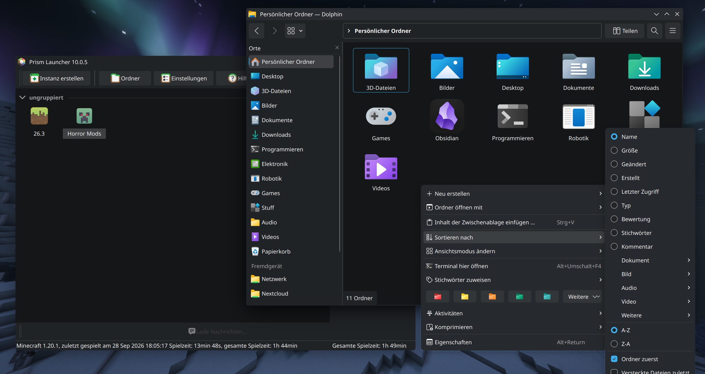

# modern-kde

A Windows 11 (WinUI 3) inspired look for Qt 6 applications on KDE Plasma: the **eleven-kde** widget style with an
optional QML overlay for System Settings and other QtQuick applications, together with the icon theme it is used with
and the Plasma theme that served as its visual reference.

> ## Credit first
>
> **None of this was designed from nothing. It stands on other people's work, please go and look at theirs:**
>
> * **The Qt Company and the Qt Project**: `QWindows11Style` and `QCommonStyle` from `qtbase` (v6.10.2) are the base of
>   the whole style. The drawing code here is a port of their code, and many comments are still theirs.
> * **The KDE community**: the Breeze style (everything the port does not draw, and all behavior, comes from it),
>   `qqc2-desktop-style` (Marco Martin, Tanbir Jishan and many others; the QML patches are modified copies of their
>   files), `plasma-nm` (Jan Grulich and others), and the Breeze SDDM theme.
> * **yeyushengfan258**: [Win11Nord-kde](https://github.com/yeyushengfan258/Win11Nord-kde), the Plasma theme this look
>   is modeled on. Its Kvantum theme is by **Vince Liuice**, based on KvAdapta by **Tsu Jan**.
> * **mjkim0727 and the contributors of Eleven-icon-theme**, successor of Cobalt-icons, which builds on Segoe Fluent,
>   Fluent-icon-theme and Cobalt-icons: the icon theme in this repository.
> * **Microsoft**, whose WinUI 3 / Fluent design the look imitates. No Microsoft source code is used.

> ## This project is vibecoded
>
> **The code in `eleven-kde` was written almost entirely by an AI** (Claude, by Anthropic) in an interactive chat
> session, steered by a human who described what should look different and tested the result by eye. **Nobody has audited
> the code line by line, there is no test suite, and it was only looked at in a handful of applications.** The same
> goes for the changes to the icon theme and the Plasma theme scripts listed in [CHANGES.md](CHANGES.md). It also
> depends on Qt private APIs. Use it at your own risk, expect rough edges, and do not take any statement in this
> repository as a guarantee: things marked as "checked" were checked by rendering or by looking at them once.

> ## Narrow compatibility
>
> **This was made on exactly one machine and works there. Anywhere else, assume it does not, until you have tried.**
>
> | Part         | What it was made and looked at with                                                                                                                                          |
> |--------------|------------------------------------------------------------------------------------------------------------------------------------------------------------------------------|
> | System       | Ubuntu / Kubuntu 26.04 LTS, x86_64, Plasma 6.6, KDE Frameworks 6.24, Wayland session                                                                                         |
> | Qt           | **exactly 6.10.2** (`6.10.2+dfsg-7`); the plugin uses private Qt headers and symbols                                                                                         |
> | Color scheme | one dark color scheme (`ElevenDark`); light schemes and high contrast were **not** looked at                                                                                 |
> | Applications | Dolphin (including properties dialog and location bar), Okular, System Settings, Konsole, Prism Launcher, KDE Partition Manager and the demo programs in `eleven-kde/tools/` |
> | QML overlay  | replaces files of `qml6-module-org-kde-desktop` found under the hard-coded path `/usr/lib/x86_64-linux-gnu/qt6/qml`                                                          |
>
> What that means in practice:
>
> * **A different Qt build means: rebuild.** After a Qt update to another version the plugin may be refused or may crash
>   (whether it is refused cleanly was not tested). Other distributions, other architectures and X11 sessions were not
>   tried.
> * **The QML overlay is a copy of a system module.** It breaks silently when that module changes, and it only exists
>   for the one directory layout above. Kirigami's own modules and the Plasma components are deliberately not patched.
> * **Class-name workarounds.** Some KDE applications paint parts of their UI themselves, so there are small fixes keyed
>   on class names (Dolphin's places panel and location bar, KDE's capacity bar, Prism Launcher's lists and icon
>   buttons, the autocomplete list). They will break or become useless when those applications change.
> * **Not affected at all:** GTK applications, Electron applications, the Plasma shell (panel, widgets) and Qt
>   applications installed as Flatpak or Snap (see below).
> * The icon theme and the Plasma theme are used as they are; their compatibility was not tested beyond what is said in
>   [CHANGES.md](CHANGES.md).



## What is in this repository

Three separate projects, side by side. Each keeps its own license, see [licenses/](licenses/README.md).

| Folder               | What it is                                                            | Origin                                                              |
|----------------------|-----------------------------------------------------------------------|---------------------------------------------------------------------|
| `eleven-kde/`        | the Qt widget style and QML overlay (the actual subject of this repo) | this project, derived from Qt, KDE Breeze and qqc2-desktop-style    |
| `Eleven-icon-theme/` | Windows 11 style icon theme                                           | third party (mjkim0727 and others), **modified**, see CHANGES.md    |
| `Win11Nord-kde/`     | Plasma theme: color scheme, window decoration, Kvantum, SDDM          | third party (yeyushengfan258), **lightly modified**, reference only |

Also: [`CHANGES.md`](CHANGES.md) says what was changed in the third-party folders, and [`licenses/`](licenses/) has every
license text.

The folders were separate git repositories before. Their old histories were dropped when this repository was
created; `licenses/changes/eleven-kde-commit-history.txt` keeps the commit list of `eleven-kde`.

## eleven-kde: what it is (and how it works)

`eleven-kde` is a `QProxyStyle` that wraps Breeze. It is **not** a from-scratch style and **not** a Plasma global theme
(no colors, cursors, window decoration or Plasma panel styling):

* The drawing code is a port of Qt's own `QWindows11Style` (`qtbase`, `src/plugins/styles/modernwindows`), which
  implements the WinUI 3 look for Windows 11. That style depends on Windows APIs and is not available in Ubuntu's Qt
  build, so it was adapted to run on Linux.
* Everything the port does not draw, and all behavior (metrics for KDE integration, palettes, shadows), comes from
  Breeze underneath.
* Colors come from your Plasma color scheme. The WinUI "Fluent" tokens are used as translucent overlays on top of it.
* The look follows the Win11Nord Plasma theme where a widget style can: gray, rounded controls, gray hover highlights,
  an accent underline on focused text fields, thin sliders with a round accent knob, and rounded scrollbars with a
  visible groove. Accent color is used only for check boxes, radio buttons, sliders, progress bars, the list selection
  marker and the focus underline; highlights, hover and "checked" states are gray.

## The QML patches

KDE's Kirigami and QtQuick Controls (switches, list highlights and popups in System Settings) are drawn by QML with
the color scheme and **do not use the widget style**. So `eleven-kde/qml/` replaces a few components of the
`org.kde.desktop` module:

| File                                                    | Change                                                                      |
|---------------------------------------------------------|-----------------------------------------------------------------------------|
| `org/kde/desktop/private/SwitchIndicator.qml`           | toggle in the shape of the Win11Nord theme: a pill with a larger round knob |
| `org/kde/desktop/private/DefaultListItemBackground.qml` | gray, borderless list highlight for QQC2 item delegates                     |
| `org/kde/desktop/MenuItem.qml`, `Menu.qml`              | gray borderless popup highlight, no accelerator underlines, no popup border |
| `kcm/kcm_networkmanagement/qml/ConnectionItem.qml`      | gray connection list on the network settings page (modified plasma-nm file) |

**These files are modified copies of KDE's files** (qqc2-desktop-style, plasma-nm). All credit for them belongs to
their authors; every file keeps their copyright lines and says what was modified. The overlay is a copy of the whole
system module with these files swapped in, and the `prefer` lines of its `qmldir` files are removed so that the files on
disk win over the QML compiled into the libraries.

**Limits, found the hard way:**

* System Settings also holds a second copy of `org.kde.desktop` from QML compiled into the system libraries, and for some
  pages the compiled delegates win over the overlay. For the network page that is why `ConnectionItem.qml` is installed
  separately (System Settings prefers `~/.local/share/kcm_networkmanagement` over `/usr/share`). It is a snapshot from
  install time: after a plasma-nm update, run the install script again. Other pages built from compiled-in delegates
  may still show the blue highlight.
* The overlay is a copy of system files. Run the install script again after Plasma updates.
* It applies to every QML application, not just System Settings.

## Status and known limitations

Looked at (and adjusted for): see the table at the top. **Dark color schemes only.** Light schemes, high contrast mode
and most other applications were not examined.

* Tied to the Qt build it was compiled against (private headers and exported private symbols).
* Anything an application draws itself with `fillRect` or QML colors ignores the style.
* Qt applications installed as Flatpak are not affected (see below).
* No rounded corners where applications paint rectangles themselves.
* The inline completion preview in Dolphin's location bar (the grayed rest of a path you are typing) is still drawn on
  KDE's near-black base color: `KLineEdit` re-applies that color on every palette change, and no clean way around it was
  found. A cosmetic issue.

### Known issue: right click in Dolphin does nothing (KDE Connect hangs)

After installing and logging in again, the context menu of files and folders in Dolphin may stop appearing. The author
saw this every time this was set up, so expect it. The cause found so far is not the menu itself but **`kdeconnectd`**
(KDE Connect): one of its threads spins at about 100 % CPU and the daemon stops answering on D-Bus. Dolphin asks it
synchronously for the "send to device" entry, so the menu never opens.

```
top -b -n1 | grep kdeconnectd                 # a hung daemon shows about 100 % CPU
gdbus call --session --dest org.kde.kdeconnect --object-path /modules/kdeconnect \
    --method org.kde.kdeconnect.daemon.devices false false     # should answer at once, not after a timeout
pkill -x kdeconnectd                          # D-Bus starts a fresh one on demand
```

* In one observed case the hung `kdeconnectd` had **never loaded this style**, and a `kdeconnectd` that had loaded the
  style ran normally. So the style is not proven to be the cause. It was not investigated further.
* The daemon may not hang on every setup. Do not rely on either statement without checking on your machine.
* Avoiding it altogether: turn off the KDE Connect entry of Dolphin's context menu, or disable KDE Connect.

### Sandboxed applications (Flatpak, and probably Snap)

**Qt applications installed as Flatpak do not use this style.** A Flatpak app runs inside a sandbox with the Qt and the
Breeze style of its own runtime, so the plugin installed on the host is not visible there, and it would not load anyway:
it is built against the host's Qt and uses Qt private APIs, which must match the Qt build of the application exactly.
Such applications keep looking like Breeze. This was observed with Qalculate! (Qt) from Flathub. Other bundled formats
(Snap, AppImages that ship their own Qt) are expected to behave the same way but were not checked.

## Build

Run these in `eleven-kde/`. Dependencies (Ubuntu/Kubuntu package names): `cmake`, `ninja-build`, a C++20 compiler,
`qt6-base-dev`, `qt6-base-private-dev`. Optional for the demo tools: `qt6-declarative-dev`, `libkf6widgetsaddons-dev`.

```
cmake -S . -B build -G Ninja -DCMAKE_BUILD_TYPE=Release
cmake --build build
```

## Try it without installing

```
QT_PLUGIN_PATH=$PWD/build/plugins dolphin -style eleven-kde
```

`-style eleven-kde` works for any Qt application. Already running single-instance applications (Prism Launcher, System
Settings) ignore the option and just raise the existing window, so close them first. For the QML overlay as well:

```
tools/make-qml-overlay.sh
QML_IMPORT_PATH=$PWD/build/qml-overlay QT_PLUGIN_PATH=$PWD/build/plugins systemsettings -style eleven-kde
```

## Install

```
tools/install-eleven-kde.sh                     # plugin + QML overlay + Application Style
tools/install-eleven-kde.sh --no-qml-overlay    # plugin + Application Style
tools/install-eleven-kde.sh --no-style          # plugin + QML overlay, pick the style yourself in System Settings
tools/install-eleven-kde.sh --dry-run           # show what would be done, change nothing
```

The plugin goes into the Qt plugin directory of the system Qt, which needs `sudo` (it needs a terminal to ask for the
password). Log out and in again afterwards, the QML overlay needs it. `tools/reinstall-eleven-kde.sh` runs the
uninstall and install scripts one after the other; **if the sudo step fails in the middle, the uninstall part has
already removed your user files and switched the style back to Breeze**, then just run the install script again.

`tools/build-deb.sh` builds two Debian packages (`eleven-kde` and `eleven-kde-qml`) into `dist/`. They pin the Qt version
and were checked for their contents only; installing them with `apt` was **not** tested.

### Uninstall / recovery

```
tools/uninstall-eleven-kde.sh --dry-run    # shows what would be removed
tools/uninstall-eleven-kde.sh
```

If a broken plugin makes the settings windows unusable, switch back to Breeze from a terminal:

```
kwriteconfig6 --file kdeglobals --group KDE --key widgetStyle Breeze
```

## The icon theme

`Eleven-icon-theme/` is a **modified** copy of a third-party icon theme (see Credit). Install it
with `Eleven-icon-theme/install.sh` (copies the themes to `~/.local/share/icons`) and choose it in System Settings >
Appearance > Icons. What was changed: 267 monochrome symbolic icons were made to follow the color scheme (they were fixed
dark gray and invisible on dark panels), and the music note emblem was replaced by a colored tile. Details and file
lists in [CHANGES.md](CHANGES.md). Its README lists Segoe Fluent as one of its sources; see
[licenses/README.md](licenses/README.md) for what that means for redistribution.

## The Plasma theme

`Win11Nord-kde/` is a third-party Plasma theme (color scheme, Aurorae window decoration, Plasma desktop theme,
look-and-feel, Kvantum theme, SDDM themes, wallpapers). It is in this repository as the **visual reference** for
`eleven-kde` and is not needed to use it. One script was edited, one script's file mode changed and three files were removed, see [CHANGES.md](CHANGES.md). Its own
`README.md` and `install.sh` describe it and were not tested as part of this repository.

## Development

* `eleven-kde/tools/gallery.cpp`: a widget gallery. `GALLERY_OUT=/tmp/x QT_PLUGIN_PATH=build/plugins build/gallery -style eleven-kde`
  renders the window, a menu and popups to PNGs without needing a screenshot of your desktop. `GALLERY_DARK=1` uses a
  dark palette and `GALLERY_HOVER=1` fakes hover on a few buttons.
* `eleven-kde/tools/qmltest.cpp`: a QML window with a few controls for the overlay.
* The style lives in `eleven-kde/src/elevenstyle.cpp`. It still follows the structure of Qt's original. See
  `eleven-kde/CLAUDE.md` for the notes the AI assistant works from.

## License

This is a collection, not one work: **each folder keeps its own license** and the Qt-derived parts of `eleven-kde` are
under the license of Qt. The short version:

| Folder               | License                                                                                               |
|----------------------|-------------------------------------------------------------------------------------------------------|
| `eleven-kde/`        | LGPL-3.0-only (Qt-derived parts: Qt's LGPL-3.0 / GPL-2.0 / GPL-3.0 choice; QML files: KDE's licenses) |
| `Eleven-icon-theme/` | GPL-3.0, as shipped by upstream (open question about Segoe Fluent, see `licenses/`)                   |
| `Win11Nord-kde/`     | GPL-3.0, as shipped by upstream (SDDM QML files: LGPL-2.0-or-later)                                   |

All texts and a file-level table are in [`licenses/`](licenses/README.md). Names of Microsoft, Qt and KDE products are
used descriptively only. "Windows", "Windows 11", "WinUI" and "Fluent" are trademarks of Microsoft Corporation. This
project is not affiliated with or endorsed by Microsoft, KDE, or The Qt Company.
